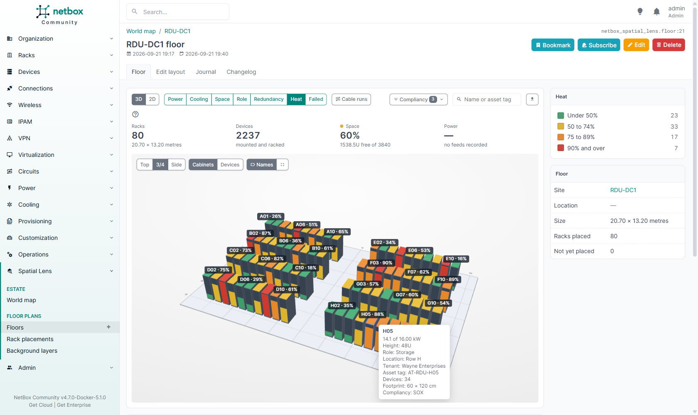
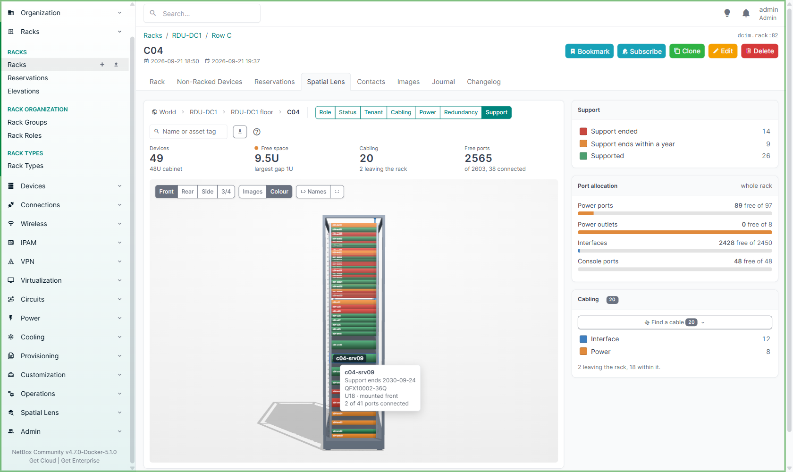
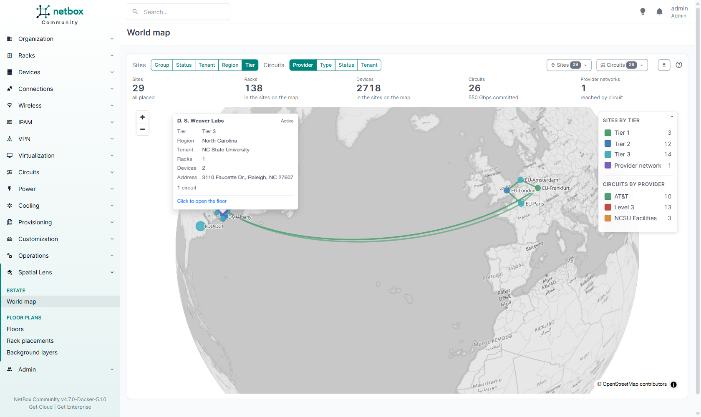
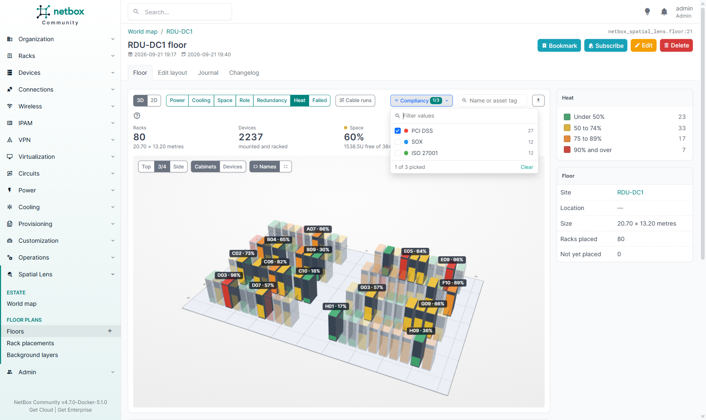

# Extending

Three ways to build on the plugin.

| Extension | How | Where it applies |
|---|---|---|
| [Colour by](#colour-by) | Code: one module in your plugin, found by itself | Floor, rack view, world map |
| [Filter by](#filter-by) | Configuration: name custom fields in `filter_custom_fields` | Floor, rack view |
| [Read a floor through the REST API](#read-a-floor-through-the-rest-api) | HTTP: two read-only endpoints | A floor |

Colourings and filters act on the same drawing. [How they combine](#how-colourings-and-filters-combine) says what the reader sees when both are in use.

## Colour by

A colouring is a function that says something about each item of a drawing: a rack, a device, a site or a circuit. The plugin draws the answer: the colour, the legend with its counts, the filter, the hover card and the gauge.

### Where the code goes

Put your colourings in a module named `spatial_lens` in your plugin, or in any installed Django app:

```text
yourplugin/
├── __init__.py
└── spatial_lens.py
```

The plugin imports that module by itself the first time it needs a colouring. There is nothing to call from `ready()`, and the order of `PLUGINS` does not matter.

Import from `netbox_spatial_lens.extend` and from nowhere else in the plugin. See [What stays stable](#what-stays-stable).

### The levels

A colouring belongs to one level: the set of things it colours.

| Level | The function gets | `context.scope` | URL parameter |
|---|---|---|---|
| `Level.RACKS` | The racks on one floor, as `Rack` objects with role, location, tenant and tags loaded | The `Floor` | `?colour=` on the floor and on the site page |
| `Level.DEVICES` | The devices mounted in one rack, as `Device` objects with role, device type, tenant and tags loaded | The `Rack` | `?colour=` on the rack view |
| `Level.SITES` | The sites on the world map, as `Site` objects with region, group and tenant loaded | `None` | `?sites=` |
| `Level.CIRCUITS` | The circuits drawn on the world map, as `Circuit` objects with provider, type and tenant loaded | `None` | `?circuits=` |

### The function

```python
@colouring(level, name, label=..., description='', bands=())
def fn(items, context):
    return {item.pk: Reading(...), ...}
```

- `name` goes in the URL and in shared links, so keep it stable.
- `label` is the button text, and `description` its tooltip.
- The function gets the whole set at once, not one item at a time. Read what you need in one query for the set, not one query per item. Custom field data is already on each item, so reading it costs no query.
- It returns a dictionary from each item's primary key to a `Reading`.
- An item that is not in the dictionary is **no data**: it is drawn grey and counted under **No data**. Zero is data; "nobody recorded it" is not.
- If the function raises, the error is logged and every item is no data. The page still opens.

### A reading

`Reading(label, band='', colour='', gauge=None, facts=())`

| Field | What it is |
|---|---|
| `label` | The sentence in the item's hover card: `'62% of 8 kW'`, `'Support ends 2030-09-24'`. On the world map, the card names it after the colouring's label, and leaves it out where the card already says it. |
| `band` | The key of the legend band the item falls in. Required when the colouring declares bands. |
| `colour` | A hex colour such as `'#4c9f70'`. Only for a colouring without bands, and optional there. |
| `gauge` | A fraction from 0 to 1, for a reading that measures a quantity. The racks on a floor draw it as a gauge and print it as a percentage. The other levels ignore it. |
| `facts` | More lines for the hover card, as `(label, text)` pairs, shown while this colouring is the one drawn. |

### The legend

A colouring has one of two kinds of legend.

**Declared bands.** Pass `bands=` when the bands exist whatever the data is, such as "how full". Each `Band(label, colour, key='')` has a key, which is the label as a slug (`'90-and-over'`) unless you give one. A reading names its band by that key, and the band gives the colour. Every band is listed, also at zero. A shared link carries the key, so keep the keys stable; the labels and the colours can change.

For a quantity, a `Scale` holds the bands with their limits and places a number for you:

```python
HEADROOM = Scale(
    (50, Band('Under 50%', '#4c9f70')),      # under 50
    (90, Band('50 to 89%', '#d9b23f')),      # under 90
    (None, Band('90% and over', '#c9483f')),  # everything else
)
reading = HEADROOM.reading(62, '62% of 8 kW')  # band '50-to-89', gauge 0.62
```

`UTILISATION` is the plugin's own four-band scale for "how full", and `COMPLETION` its six-band scale for "how complete". Use them so that your colouring reads like the built-in ones.

**Bands from the data.** Pass no bands when the values are names, such as tenants. The legend then has one entry per distinct `label`, in name order. Leave `colour` empty and each label gets a colour that is stable across restarts and that no other label wears. Give a `colour` when the name has one of its own, such as a role. `by_name(items, 'tenant')` builds these readings from a related object.

The **No data** entry is always added last, when something falls in it.

### The context

The second argument says where the colouring is asked.

| Field | What it is |
|---|---|
| `context.level` | The `Level`. |
| `context.user` | The reader. `None` when nobody is logged in to ask, as in a management command. |
| `context.scope` | What the drawing is of: the `Floor`, the `Rack`, or `None` on the map. |
| `context.visible(queryset)` | The queryset, restricted to what the reader may view. |
| `context.mounted` | `Level.DEVICES` only: what the rack view already knows of each device, by device id, with `port_count`, `connected_count` and `power` (`allocated_watts`, `maximum_watts`, or `None`). |

### Permissions

Every page draws only the items the reader may view, so the items your function gets are safe to read. If the function reads other objects, such as the devices in a rack, restrict them with `context.visible()`, so a label never names what the reader may not see. For data outside NetBox, such as a monitoring system, decide with `context.user`.

### Example

This file is a whole extension. It adds four colourings.

```python
# yourplugin/spatial_lens.py
from datetime import date

from dcim.models import Device

from netbox_spatial_lens.extend import UTILISATION, Band, Level, Reading, colouring, palette


@colouring(Level.RACKS, 'heat', label='Heat', description='Heat load against cooling capacity.', bands=UTILISATION)
def heat(racks, context):
    readings = {}
    for rack in racks:
        load = rack.custom_field_data.get('heat_load_kw')
        if load is None or not rack.cooling_capacity:
            continue  # no data: grey, and counted under "No data"
        percent = float(load) / float(rack.cooling_capacity) * 100
        readings[rack.pk] = UTILISATION.reading(percent, f'{load:g} of {rack.cooling_capacity:g} kW')
    return readings


FAILED = (
    Band('No failed device', palette.STATUS_COLOURS['green'], key='none'),
    Band('A failed device', palette.STATUS_COLOURS['red'], key='some'),
)


@colouring(Level.RACKS, 'failed', label='Failed', description='The racks with a failed device.', bands=FAILED)
def failed(racks, context):
    # Only the devices the reader may view: the card names them.
    devices = context.visible(Device.objects.filter(rack__in=racks, status='failed'))
    names = {}
    for rack_id, name in devices.values_list('rack_id', 'name'):
        names.setdefault(rack_id, []).append(name)
    readings = {}
    for rack in racks:
        if rack.pk in names:
            failed_names = sorted(names[rack.pk])
            readings[rack.pk] = Reading(f'{len(failed_names)} failed', band='some', facts=[('Failed', ', '.join(failed_names))])
        else:
            readings[rack.pk] = Reading('No failed device', band='none')
    return readings


SUPPORT = (
    Band('Support ended', palette.STATUS_COLOURS['red'], key='ended'),
    Band('Support ends within a year', palette.STATUS_COLOURS['orange'], key='ending'),
    Band('Supported', palette.STATUS_COLOURS['green'], key='supported'),
)


@colouring(Level.DEVICES, 'support', label='Support', description='When vendor support ends.', bands=SUPPORT)
def support(devices, context):
    today = date.today()
    readings = {}
    for device in devices:
        end = device.custom_field_data.get('support_end')
        if not end:
            continue  # no data
        days = (date.fromisoformat(end) - today).days
        band = 'ended' if days < 0 else 'ending' if days < 365 else 'supported'
        readings[device.pk] = Reading(f'Support ends {end}', band=band)
    return readings


@colouring(Level.SITES, 'tier', label='Tier', description='The service tier of each site.')
def tier(sites, context):
    tiers = {site.pk: site.custom_field_data.get('service_tier') for site in sites}
    return {pk: Reading(name) for pk, name in tiers.items() if name}
```

**Heat** colours each rack by a heat load recorded in a rack custom field, `heat_load_kw`, against the rack's own cooling capacity. A rack with either value missing is no data. Each rack is gauged, and the legend has the plugin's four bands.



**Failed** marks the racks that hold a device in the Failed status, and names those devices in the hover card. It reads other objects, so it restricts them to what the reader may view.

**Support** colours each device by a date custom field, `support_end`, in three declared bands, with the date in its hover card.



**Tier** colours each site by a select custom field, `service_tier`. The values are names, so the legend is built from the data: one entry per tier in use.



### Replacing or removing a built-in colouring

A colouring registered under the name of a built-in one replaces it: `@colouring(Level.RACKS, 'power', ...)` takes the place of the plugin's **Power**. If two plugins register the same name, the one imported last wins and a warning is logged.

To remove a built-in colouring, leave it out of `builtin_rack_colourings`, `builtin_device_colourings`, `builtin_site_colourings` or `builtin_circuit_colourings` (see [Configuration](configuration.md)).

### Which colouring a page opens with

The one named in the URL. If no colouring has that name, the default from the settings (`default_rack_colouring`, `default_device_colouring`, `default_site_colouring` or `default_circuit_colouring`). If no colouring has that name either, the first one registered. A link to a colouring that no longer exists still opens the page.

On the floor, a default colouring that has no data for any rack gives way to the first colouring that has some, and the page says so. A colouring named in the URL is kept as it is.

### What stays stable

`netbox_spatial_lens.extend` is the public interface: `colouring`, `Level`, `Reading`, `Band`, `Scale`, `Context`, `by_name`, `UTILISATION`, `COMPLETION` and `palette`. A change to one of these names, or to what a colouring function gets and returns, is listed under **Upgrade notes** in the changelog. Everything else in the plugin can change in any release.

### Upgrading a colouring from 0.5

| 0.5 | 0.6 |
|---|---|
| `register_overlay`, `register_device_overlay`, `register_site_overlay`, called from `ready()` | `@colouring(Level.RACKS \| DEVICES \| SITES \| CIRCUITS, ...)` in `yourplugin/spatial_lens.py` |
| `def fn(items)` | `def fn(items, context)` |
| `RackValue(colour, label, value)` | `Reading(label, band=..., colour=..., gauge=...)` |
| `value=None` for no data | Leave the item out |
| `value=62` draws a gauge | `gauge=0.62`, or `UTILISATION.reading(62, label)` |
| `legend=[LegendEntry(colour, label)]`, a value placed by its colour | `bands=[Band(label, colour)]`, a reading placed by `band=<key>` |
| `UTILISATION_LEGEND` and `utilisation_colour(percent)` | `UTILISATION` and `UTILISATION.reading(percent, label)` |
| The rack view hands over mounted devices, keyed by `m.device.pk` | It hands over `Device` objects; the port counts and the power are in `context.mounted[device.pk]` |
| `distinct_colours(names)` for a legend from the data | Leave `colour` empty |
| Settings `enable_builtin_overlays`, `default_overlay` | `builtin_rack_colourings`, `default_rack_colouring` |
| Settings `enable_builtin_device_overlays`, `default_device_overlay` | `builtin_device_colourings`, `default_device_colouring` |
| Settings `enable_builtin_site_overlays`, `default_site_overlay` | `builtin_site_colourings`, `default_site_colouring` |
| `?overlay=` on the floor, the site page and the world map | `?colour=` on the floor and the site page, `?sites=` on the world map |

## Filter by

A select or multiselect custom field can narrow the floor and the rack view the way tags do. Name the fields in the `filter_custom_fields` setting; no code is needed.

```python
PLUGINS_CONFIG = {
    'netbox_spatial_lens': {
        'filter_custom_fields': ['compliancy', 'support_contract'],
    },
}
```

| Level | A field assigned to | Gets |
|---|---|---|
| Floor, in 3D and in 2D | Racks | A button beside **Tags**, a column in the rack table, and a line in the rack's hover card |
| Rack view | Devices | A button beside **Tags** |

The world map has no custom field filters.



- The button lists the values in use on the page, with how many racks or devices carry each, in the order of the field's choices. A field with no value in use gets no button.
- Each value wears the colour of its choice in the choice set. A choice with no colour gets one that no other value on the page wears.
- Tick values to narrow the drawing to the racks or devices with any of them.
- The buttons come in the order the setting names the fields.
- A field that is not select or multiselect, not assigned to racks or devices, or hidden in the UI, is skipped. A name that matches no field is skipped too, so a typo does not stop NetBox from starting.

## How colourings and filters combine

A drawing has one colouring and several ways to narrow it: the legend, the **Tags** finder, a finder per custom field, and the find box. On the world map, the **Sites** and **Circuits** finders and the circuit legend narrow it too.

- In one legend or one finder, picks add up: tick two values and the items with either one stay lit.
- Across them, picks narrow each other: an item stays lit only if it is kept by every legend, every finder and the find box.
- Nothing picked in a legend or a finder keeps every item.
- The picks are kept in the URL hash and the colouring in the query string, so a reload or a copied link opens the drawing narrowed the same way.
- Escape clears every pick.

So a legend band from your colouring and a custom field value work together: "the PCI DSS racks over 90% of their cooling capacity" is one band and one tick.

## Trying the examples

The dev stack registers every example on this page, read from this page, so what you see is what the page says. See [Development](development.md#the-extending-examples).

## Read a floor through the REST API

`GET /api/plugins/spatial-lens/floors/<id>/layout/` returns everything one drawing of the floor needs, for a renderer of your own. It applies the same permissions as the floor page: racks and devices the caller may not view are left out.

| Query parameter | Effect |
|---|---|
| `colour=<name>` | The colouring to evaluate, chosen as the floor page chooses it (see [Which colouring a page opens with](#which-colouring-a-page-opens-with)). |
| `runs=1` | Also return the cable runs between racks and the cables that leave the floor. |

Positions and sizes are in centimetres from the room's top-left corner. A rack's `x` and `y` are its centre.

| Key | Holds |
|---|---|
| `floor` | `id`, `name`, `width_cm`, `depth_cm` |
| `colouring` | `name`, `label`, and `legend` as a list of `band` (its key), `colour`, `label` and `count`; `null` when no colouring is registered |
| `racks` | For each rack: `rack_id`, `name`, `x`, `y`, `rotation` (degrees clockwise), `width`, `depth`, `u_height`, `estimated_footprint`, `colour`, `label`, `band` (the key of its legend band), `fraction` (0 to 1, or `null` when the colouring measures no quantity) and `facts` (label and value pairs) |
| `layers` | The enabled background images: `id`, `name`, `source` (the image URL), `x`, `y`, `width`, `height`, `rotation`, `opacity` |
| `runs` | With `runs=1`: `rack_a`, `rack_b` and the `count` of cables between them |
| `exits` | With `runs=1`: `rack`, the `label` and `kind` of what the cables reach, their `count`, and the `x` and `y` of the point on the wall |

`GET /api/plugins/spatial-lens/floors/<id>/devices/` returns the devices in every rack on the floor, as the floor's Devices view draws them, with the same permissions. It has one entry in `racks` per placed rack:

| Key | Holds |
|---|---|
| `id` | The rack's id, as `rack_id` in the layout |
| `cabinet` | The cabinet in millimetres, centred on its footprint with its front towards +z: `width`, `depth`, `height`, `plinth`, `interior`, `faceplate`, `frontRailZ`, `rearRailZ` |
| `devices` | For each mounted device: `id`, `label`, `url`, `assetTag`, `box` (centre x, y, z and width, height, depth, in the cabinet's millimetres), `facing` (`front` or `rear`), `images` (`front` and `rear` URLs, empty when the device type has none), `colour` and `facts` |

The three models also have the usual NetBox endpoints: `floors`, `rack-placements` and `floor-layers` under `/api/plugins/spatial-lens/`.
